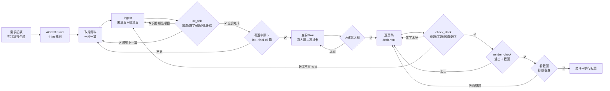

# Loop / Graph 設計

整體是一個 **graph**：關卡順序是事先畫好的，錯在哪一關就退回哪一關。每個節點裡面再是一個 **loop**：做 → 檢查 → 只修報告列出的問題，最多 3 輪。

## 流程圖

文字版：**取得資料 → Ingest 進 Wiki → lint → 查詢 Wiki 寫證據卡 → 人確認 → 逐頁稿 → 程式檢查 → 渲染檢查 → 看截圖 → 交件**

## 每一關只能看什麼、改什麼

| 節點 | 輸入（只能看） | 輸出（檔案） | 不能做 |
|---|---|---|---|
| Ingest | 一篇來源 | `wiki/sources/*.md`、更新 `wiki/concepts/*.md` | 一次處理多篇；寫來源沒有的數字 |
| 證據卡 | `wiki/` | `slides/outline.md` | 用 wiki 以外的知識 |
| 逐頁稿 | 大綱＋該頁引用的 wiki 頁 | `slides/deck.html` | 引用沒列在 `data-sources` 的內容 |
| 檢查關卡 | 成品＋來源 | `docs/run-report.md` | 修改內容（只報告） |

## 哪些步驟會重複執行？
- **Ingest loop**：每篇資料都跑一次「寫頁 → lint → 修」，共 6 次。
- **逐頁稿 loop**：「寫 → check_deck → 只修出錯的頁」，最多 3 輪。
- **渲染 loop**：「渲染 → 截圖 → 修版面 → 再渲染」。

## 哪些地方需要檢查或重新生成？
| 錯誤 | 在哪裡被抓到 | 退回哪裡 |
|---|---|---|
| 概念頁缺出處、死連結、孤兒頁 | lint_wiki | Ingest（只修那一頁） |
| 數字在來源頁找不到 | lint_wiki | Ingest（補來源頁，不是改概念頁） |
| 簡報數字不在引用的 wiki 頁 | check_deck | 補 `data-sources` 或退回 Ingest |
| 每頁字太多 | check_deck | 逐頁稿（只縮那一頁） |
| 溢出、排版失衡 | render_check＋看截圖 | 逐頁稿（只改 CSS／那一頁） |

## 為什麼這樣設計？
1. **錯誤要在離源頭最近的地方被抓到**：數字錯通常是在 ingest 時就寫錯，所以數字檢查放在 lint（ingest 後），不是等到簡報做完才查。
2. **一次一篇**：如果 lint 失敗，就知道是哪一篇造成的。
3. **程式檢查管「找得到」，看圖／AI 審查管「看得懂、沒講反」**：腳本能確認數字存在，但不能確認意思對（見 reflection.md 的 50 vs 150 例子）。
4. **有剎車**：每個 loop 最多 3 輪；wiki 資料不夠就退回取得資料，不硬湊。
